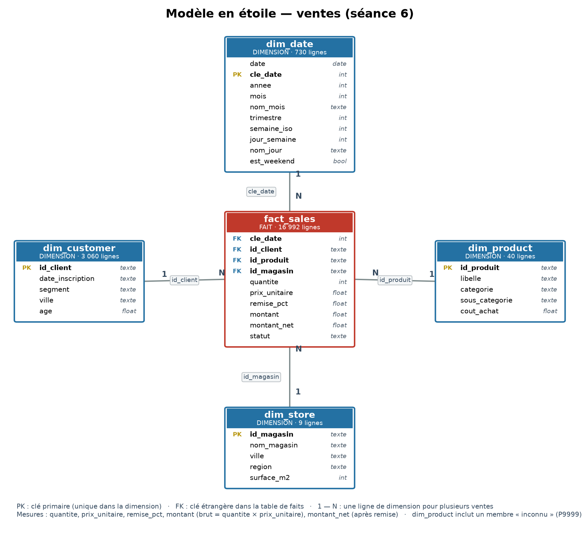

# PMD — Notebooks de séance (environnement, pandas, nettoyage, transformation, temps, jointures)

Projets du module **Préparation et Manipulation de Données** (M1) :

- **Séance 1 — Fondations** (`01_environnement_numpy.ipynb`) : mise en place d'un
  environnement Python reproductible et manipulation de tableaux NumPy (slicing,
  masques booléens, statistiques par axe, vectorisation).
- **Séance 2 — Exploration pandas** (`02_pandas_exploration.ipynb`) : lecture de
  sources multiples (CSV/Excel/JSON), sélection et filtrage avec `loc`/`iloc`, et
  écriture de la fonction réutilisable `profile_dataframe` (`src/exploration.py`).
- **Séance 3 — Nettoyage et qualité** (`03_nettoyage_qualite.ipynb`) : typologie
  des valeurs manquantes, détection des valeurs aberrantes (IQR vs score z),
  normalisation de texte et écriture de la fonction idempotente `clean_sales`
  (`src/cleaning.py`).
- **Séance 4 — Transformation et encodage** (`04_transformation_encodage.ipynb`) :
  mise à l'échelle (min-max, z-score), fuite de données, encodage one-hot avec
  regroupement des modalités rares, variables dérivées, et fonction
  `prepare_features` (`src/transformation.py`).
- **Séance 5 — Variables temporelles** (`05_variables_temporelles.ipynb`) : parsing
  de dates hétérogènes avec rapport de conversion, variables calendaires,
  rééchantillonnage et moyennes mobiles, détection de pannes et de capteurs
  bloqués, saisonnalité mensuelle (`src/temporal.py`).
- **Séance 6 — Agrégation et jointures** (`06_agregation_jointures.ipynb`) :
  `agg`/`transform`/`apply`, tableaux croisés, jointures contrôlées (`validate`,
  `safe_merge`), formats long et large, modèle en étoile pour la BI et contrôle
  d'intégrité référentielle (`src/joins.py`).

## Structure du dépôt

- `src/` : code réutilisable (`exploration.py`, `cleaning.py`, `transformation.py`,
  `temporal.py`, `joins.py`).
- `data/processed/` : jeux produits par les notebooks (`ventes_nettoyees.parquet`,
  `journal_nettoyage.json`, `ventes_transformees.parquet`, `ventes_temporelles.parquet`).
- `data/processed/star/` : modèle en étoile pour Power BI / Tableau (`fact_sales`,
  `dim_date`, `dim_customer`, `dim_product`, `dim_store`).
- `docs/schema_etoile.png` (et `.svg`) : schéma du modèle en étoile.


- `requirements.txt` : dépendances figées.

## Installation

```bash
python -m venv .venv
source .venv/bin/activate        # Windows : .venv\Scripts\activate
pip install -r requirements.txt
jupyter lab
```

## Données

Le dossier `data/raw/` (exclu du dépôt via `.gitignore`) contient les données
brutes en lecture seule ; toute transformation est écrite dans
`data/processed/`, jamais dans `data/raw/`.